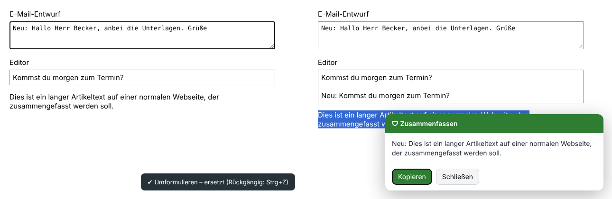

# 🛡 Datenwächter

Prüft Texte, PDFs, Word-Dateien, Bilder und Fotos, **bevor** sie in Claude, ChatGPT, Codex & Co. landen.
Alles läuft lokal auf deinem PC, es geht nichts ins Internet.

Der Datenwächter beantwortet zwei Fragen:

1. **Welche sensiblen Daten stecken drin?** Zum Beispiel IBAN, Namen, Adressen, API-Schlüssel oder Gesichter auf Fotos.
2. **Was lädst du da eigentlich hoch?** Zum Beispiel: *„Du lädst gerade Familienunterlagen hoch (Sorgerecht, Jugendamt, Tochter). Willst du das wirklich?“*

Danach entscheidest du: **anonymisiert hochladen**, **Original hochladen** oder **abbrechen**.

| Inhalts-Check | Fundliste |
|---|---|
|  |  |

## Oberfläche: Tray-Symbol, Fenster und Browser-Leiste

Ein **Schild im Infobereich** zeigt auf einen Blick den Zustand: grün = Schutz aktiv, blau = prüft gerade,
rot = Warnung, orange = pausiert. Ein **Rechtsklick** öffnet das Menü mit diesen Punkten: Schutz an/aus,
15 Minuten pausieren, Datei prüfen, KI-Antwort zurückübersetzen, Einstellungen, Mit Windows starten und Beenden.
Kommt eine Warnung, während das Fenster geschlossen ist, erscheint eine Windows-Benachrichtigung.


- **Ein Schalter** schaltet den Schutz an und aus. Nach einer Pause schaltet er sich automatisch wieder ein.
- Die **Ablagefläche** prüft Dateien, die du hineinziehst.
- Die **Tageszähler** zeigen geprüft, gewarnt und anonymisiert. Gezählt werden nur Zahlen, keine Inhalte.
- **„Zuletzt“** zeigt die letzten Ereignisse mit Uhrzeit.
- **Schließen (X)** blendet nur das Fenster aus, der Schutz läuft im Infobereich weiter. Mit „Mit Windows starten“ läuft der Datenwächter ab der Anmeldung (`datenwaechter gui --minimiert`).
- Das Fenster ist **hell oder dunkel**, passend zur Windows-Einstellung.

**In der Browser-Leiste** zeigt das Datenwächter-Symbol denselben Zustand. Pausiert trägt es den Hinweis „AUS“.
Ein Klick zeigt Schalter, Pause-Knöpfe, die Tageszähler und ob der lokale Scanner und der KI-Server verbunden sind.


**Anonymisieren heißt bei PDFs und Bildern schwärzen.** Das Layout bleibt erhalten. Funde werden mit einem Kasten
samt Platzhalter überdeckt, Gesichter werden verpixelt. Der Originaltext ist danach nicht mehr in der Datei enthalten.


## Was geprüft wird

| | Wie | Ergebnis beim Anonymisieren |
|---|---|---|
| Text, Code, CSV, JSON … | Regeln mit Prüfsummen | Platzhalter wie `[IBAN_1]` |
| Word (.docx) | Regeln | .docx mit Platzhaltern |
| PDF mit Text | Regeln, Position jedes Zeichens | geschwärztes PDF |
| **Eingescanntes PDF** | Texterkennung (OCR) | geschwärztes PDF |
| **Bilder / Screenshots** | Texterkennung (OCR) | geschwärztes Bild |
| **Fotos von Personen** | Gesichtserkennung (OpenCV) | Gesichter verpixelt |
| **Motiv eines Fotos** („Ausweis“, „Kind am Strand“) | KI-Server mit Bildverständnis (optional) | Warnung mit Beschreibung |

**Sensible Daten:** IBAN, Kreditkarte, Steuer-ID (jeweils mit Prüfsumme), Sozialversicherungsnummer, Ausweis-/Passnummer, API-Schlüssel
(Anthropic, OpenAI, AWS, GitHub, Google, Slack, Stripe), private Schlüssel, Tokens, Passwörter, Datenbank-Zugänge,
Namen (nach Anrede, mit KI-Modell auch ohne), E-Mail, Telefon, Adressen, Geburtsdatum, IP-Adressen.

**Inhalts-Check:** Familie, Gesundheit, Finanzen, Recht, Personal/Arbeit, Ausweise, Firmeninterna und besonders
geschützte Daten nach Art. 9 DSGVO (Religion, Politik, Gewerkschaft, Sexualität). Ohne weitere Installation arbeitet
der Check mit Stichwörtern ([`kategorien.json`](datenwaechter/kategorien.json), leicht erweiterbar). Mit einem
**KI-Server** (siehe unten) liest ein Sprachmodell den Inhalt tatsächlich und bewertet auch Fotos.

## KI-Server für den Inhalts-Check: Ollama oder eigener OpenAI-kompatibler Server

Du kannst jeden Server nutzen, der die OpenAI-Schnittstelle (`/v1/chat/completions`) spricht, mit eigener URL und eigenem Token.
Beispiele: LM Studio, vLLM, LocalAI, llama.cpp-Server, Ollama im OpenAI-Modus, ein Firmen-Gateway, OpenRouter, Mistral oder OpenAI.

| Im Fenster | Kommandozeile |
|---|---|
|  | `datenwaechter ki-server --url http://localhost:1234/v1 --modell qwen2.5-7b-instruct --testen`<br><br>Mit Token (`-` liest es von der Eingabe, damit es nicht im Verlauf landet):<br>`datenwaechter ki-server --url https://gateway.firma.de/v1 --token - --testen` |

- **„Modelle laden“** holt die Liste vom Server, **„Verbindung testen“** schickt eine kleine Testanfrage.
- **Ein Ort für alles:** Fenster, Kommandozeile und Browser-Erweiterung nutzen dieselbe Einstellung (`%APPDATA%\Datenwaechter\einstellungen.json`).
- **Token:** Mit `keyring` (im Paket `[windows]` enthalten) liegt es in der Windows-Anmeldeinformationsverwaltung, sonst in der Einstellungsdatei.
- **Firmen-Rollout:** Die Umgebungsvariablen `DATENWAECHTER_LLM_URL`, `DATENWAECHTER_LLM_TOKEN` und `DATENWAECHTER_LLM_MODELL` haben Vorrang.
- **Server ohne JSON-Modus oder ohne Bildverständnis** funktionieren auch, der Datenwächter fragt dann automatisch ohne diese Funktionen nach.
- **Auch kleine lokale Modelle funktionieren.** Der Datenwächter stellt dem Modell einfache Ja/Nein-Fragen, z. B. „Sind Menschen zu sehen?“, „Ist es ein Ausweis?“, „Geht es um Gesundheit?“, statt es Kategorien auswählen zu lassen. Den Warnsatz baut er selbst. Die Stichwörter laufen immer zusätzlich mit, falls das Modell etwas übersieht.

**Mit einem echten Bildmodell getestet** (Qwen2-VL-2B, nur CPU, 4 Kerne, etwa 20 bis 35 Sekunden pro Bild):

| Bild | Ergebnis |
|---|---|
| Personenfoto (ohne Text) | „Du lädst gerade Fotos von Personen hoch“, dazu 1 Gesicht erkannt |
| Personalausweis (Muster) | „Fotos von Personen und Ausweisdokumente“, dazu Ausweisnummer und Geburtsdatum per OCR |
| Katze, Kaffeetasse | keine Warnung |
| Abfotografierter Arztbrief | „Gesundheitsdaten“, Name, Geburtsdatum und Telefon per OCR |

Mit einer Grafikkarte oder einem größeren Modell (z. B. `gemma3:4b` über Ollama) geht es schneller und genauer.

**Datenschutz bei externen Servern:** Liegt der Server außerhalb deines Rechners oder Netzes (z. B. `api.openai.com`),
zeigt der Datenwächter eine Warnung. Er stellt außerdem automatisch Folgendes ein:
- Der Text wird **vor dem Senden anonymisiert**: Aus Namen, IBAN usw. werden Platzhalter. Für die Frage „Was ist das für ein Inhalt?“ braucht die KI keine echten Daten.
- **Bilder werden nicht mitgeschickt.**

Beides lässt sich umstellen. Im Warndialog steht dann z. B. *„Bewertet von KI-Server (gpt-4o-mini@api.openai.com) – Inhalt wurde anonymisiert an api.openai.com gesendet“*.


## KI-Aktionen: „Formuliere das um“ & eigene Aktionen per Rechtsklick

Markierten Text mit deinem KI-Server bearbeiten: umformulieren, kürzen, freundlicher oder professioneller
formulieren, Rechtschreibung korrigieren, übersetzen, zusammenfassen, eine Antwort entwerfen oder **eigene Aktionen**.

- **Im Browser, auf jeder Webseite:** Text markieren, **Rechtsklick** und dann **„Mit KI bearbeiten …“** wählen. Die Aktionsleiste öffnet sich direkt an der Markierung. Das Ergebnis ersetzt die Markierung im Eingabefeld oder wird darunter eingefügt. Auf normalem Seitentext erscheint es in einer Karte zum Kopieren. Ist nichts markiert, wird das ganze Eingabefeld genommen. Strg+Z macht die Änderung rückgängig.
- **In jedem Windows-Programm** (Outlook, Word, Teams, Desktop-Apps): Text markieren und **Strg+Alt+Leertaste** drücken. Dieselbe Aktionsleiste erscheint am Mauszeiger, das Ergebnis wird an Stelle der Markierung eingesetzt. Ein eigener Eintrag im Rechtsklick-Menü fremder Programme ist unter Windows technisch nicht möglich. Das Tastenkürzel lässt sich ändern.
- **Datenschutz:** Ist dein KI-Server extern, ersetzt der Datenwächter Namen, IBAN usw. vor dem Senden durch Platzhalter und setzt die echten Werte in der Antwort wieder ein. Der Anbieter sieht die echten Daten nie.

**Die Aktionsleiste:** Sie zeigt eine Vorschau des markierten Texts, ein Suchfeld und die Aktionen mit Symbol. Ein Hinweis
erscheint, wenn eine Aktion etwas anderes tut als ersetzen („zeigt an“, „fügt ein“). Bedienen lässt sie sich mit Maus
oder ↑ ↓ Enter Esc. **Tippen filtert.** Passt nichts, führst du das Getippte direkt als **eigene Anweisung** aus,
z. B. „in Reimform“ oder „als Liste für Kollegen“. Sie ist hell oder dunkel und hat unter Windows 11 runde Ecken und einen Schatten.

| Browser (hell / dunkel, eigene Anweisung) | Windows (hell / dunkel, eigene Anweisung) |
|---|---|
|  |  |

**Eigene Aktionen** legst du im Fenster unter *Einstellungen → KI-Aktionen bearbeiten* an. Jede Aktion hat einen
Namen, eine Anweisung an die KI und eine Einstellung, was mit dem Ergebnis passiert: *Markierung ersetzen*,
*darunter einfügen* oder *nur anzeigen*. Browser-Menü und Tastenkürzel nutzen dieselbe Liste.


Per Kommandozeile:
```
datenwaechter aktionen                                         # Liste anzeigen
datenwaechter aktionen --neu "Als Tweet" --anweisung "Mach daraus einen Tweet (max. 280 Zeichen)" --modus anzeigen
datenwaechter aktion Umformulieren --text "hallo herr becker anbei die unterlagen"
```

## Die zwei Bausteine

### 1. Browser-Erweiterung (Chrome / Edge / Brave) für claude.ai, chatgpt.com, Gemini, Copilot …

Fängt **alle Upload-Wege** ab, *bevor* die Seite die Daten bekommt:

- **Drag & Drop** von Dateien oder Text
- **„Datei hinzufügen“ / Büroklammer**, auch bei Knöpfen mit unsichtbarem Eingabefeld und beim modernen Dateidialog (`showOpenFilePicker`)
- **Einfügen (Strg+V)** von Text, Dateien oder Screenshots

Kopierst du später eine KI-Antwort mit Platzhaltern, setzt die Erweiterung die echten Werte automatisch wieder ein.

**Installieren:**
1. `chrome://extensions` (bzw. `edge://extensions`) öffnen und den **Entwicklermodus** einschalten
2. **Entpackte Erweiterung laden** und den Ordner `extension/` wählen
3. Für PDFs, Bilder und Fotos den lokalen Scanner installieren (Abschnitt 2 unten). Dann die angezeigte **ID** kopieren und ausführen:
   ```
   python install_browser_bridge.py <ERWEITERUNGS-ID>
   ```
   Danach den Browser neu starten. Ohne diesen Schritt prüft die Erweiterung nur Text und Textdateien.

### 2. Lokaler Scanner + Windows-Fenster (auch für Claude Desktop, ChatGPT-App, Codex)

```
pip install ".[windows,gesichter]"     # Tray-Symbol, Windows-Texterkennung, Zwischenablage, Drag & Drop, Gesichter
datenwaechter-gui                      # Fenster + Tray-Symbol starten
datenwaechter gui --minimiert          # nur als Tray-Symbol starten
```

Desktop-Apps lassen sich nicht sauber beim Hineinziehen abfangen. Das ginge nur per DLL-Injektion, und die wird von
Virenscannern blockiert. Auch ihren eigenen „Datei hinzufügen“-Dialog kann kein anderes Programm abfangen.
Das Fenster setzt deshalb an der **Zwischenablage** und an einer eigenen **Ablagefläche** an:

- **Text kopiert:** Im *sicheren Modus* liegt sofort nur noch die anonymisierte Fassung in der Zwischenablage. Das Original holst du mit einem Klick zurück.
- **Screenshot kopiert (Win+Umschalt+S):** Das Bild wird gelesen. Bei Funden kommt die Warnung, und die geschwärzte Fassung geht in die Zwischenablage.
- **Datei im Explorer kopiert (Strg+C):** Die Datei wird geprüft, Strg+V im Chat fügt die geschwärzte Kopie ein.
- **Datei ins Fenster ziehen:** Die geschwärzte Kopie erscheint im Explorer und kann direkt in die App weitergezogen werden.
- **KI-Antwort zurückübersetzen:** Platzhalter werden wieder zu echten Namen.


### Optionale Zusätze

| Zweck | Installation |
|---|---|
| Texterkennung ohne Windows-OCR | [Tesseract](https://github.com/UB-Mannheim/tesseract/wiki) mit Sprachpaket „Deutsch“, dann `pip install ".[tesseract]"` |
| Inhalts-Check und Fotos mit lokaler KI ohne Einrichtung | [Ollama](https://ollama.com) installieren, `ollama pull gemma3:4b` (~3 GB, versteht Text **und** Bilder). Wird automatisch erkannt. Anderes Modell: Umgebungsvariable `DATENWAECHTER_OLLAMA_MODELL` |
| Eigener KI-Server mit URL + Token | siehe Abschnitt „KI-Server“ oben |
| Namen ohne Anrede | `pip install ".[ki]"` (GLiNER, ~600 MB, CPU) |

## Kommandozeile

```
datenwaechter scan Vertrag.pdf Foto.jpg kunden.csv   # Exit-Code 2 = kritische Funde
datenwaechter anonymisieren Scan.pdf --zuordnung     # schreibt Scan_anonymisiert.pdf
```

## Grenzen

- Ohne KI-Server mit Bildverständnis bewertet der Datenwächter das *Motiv* eines Fotos nicht. Er findet dann nur Text im Bild und Gesichter.
- Gesundheitsangaben im Text (z. B. „Diagnose: Depression“) lösen eine Warnung aus, werden beim Anonymisieren aber nicht geschwärzt. Geschwärzt werden Namen, Nummern, Kontakt- und Adressdaten.
- Die Gesichtserkennung (OpenCV) findet vor allem frontale Gesichter. Bei Profilen, kleinen oder verdeckten Gesichtern kann sie etwas übersehen.
- Handschrift erkennt die Texterkennung kaum.
- Geschwärzte PDFs bestehen aus Seitenbildern, Text lässt sich darin nicht mehr markieren. Claude und ChatGPT lesen sie trotzdem.
- Bilder *innerhalb* von Word-Dateien werden noch nicht geprüft.
- In Desktop-Apps (Claude Desktop, Codex) fängt das Tool den eigenen „Datei hinzufügen“-Dialog nicht ab. Dort schützt nur der Weg über die Zwischenablage oder die Ablagefläche.
- Die Erweiterung hängt am Aufbau der Chat-Seiten. Ändert ein Anbieter seine Upload-Logik, muss sie eventuell nachgezogen werden.
- Es ist eine Schutzschicht gegen Versehen, keine Garantie.

## Entwicklung

```
pip install -e ".[dev]"
pytest                               # Regeln, Inhalts-Check (simuliertes Ollama + OpenAI-Server), OCR, Schwärzen, Gesichter, Oberfläche
node --test tests/detectors.test.js  # Browser-Regeln (gleiche Testfälle wie Python)
node tests/e2e_extension.js          # Erweiterung in echtem Chromium: Upload-Wege, Scanner, KI-Server, Leisten-Fenster, Pause
node tests/e2e_ki_aktionen.js        # KI-Aktionen im Rechtsklick-Menü (ersetzen, einfügen, anzeigen)
SITE=chatgpt.com node tests/e2e_extension.js   # dasselbe unter der Adresse von ChatGPT
```

Die Erkennungsregeln gibt es zweimal, in `datenwaechter/detectors.py` und `extension/detectors.js`. Die Tests
prüfen beide mit denselben Beispielen. Die Stichwörter stehen nur in `datenwaechter/kategorien.json`. Nach einer
Änderung erzeugst du die Browser-Fassung neu:
`python -c "import datenwaechter.content_check as c; c.write_extension_categories()"`
