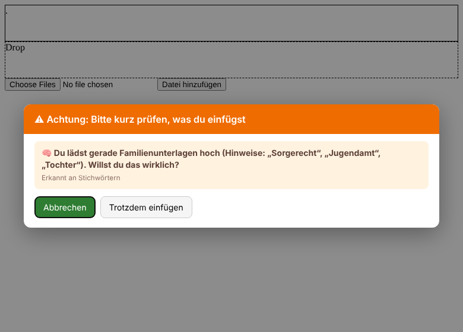
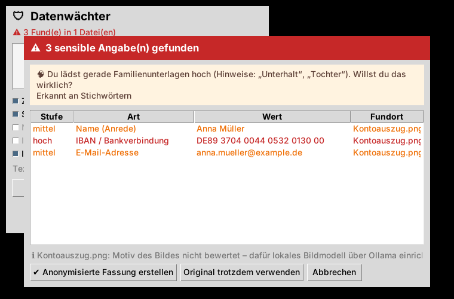

# 🛡 Datenwächter

Prüft Texte, PDFs, Word-Dateien, Bilder und Fotos, **bevor** sie in Claude, ChatGPT, Codex & Co. landen.
Alles läuft lokal auf deinem PC, es geht nichts ins Internet.

Der Datenwächter beantwortet zwei Fragen:

1. **Welche sensiblen Daten stecken drin?** Zum Beispiel IBAN, Namen, Adressen, API-Schlüssel oder Gesichter auf Fotos.
2. **Was lädst du da eigentlich hoch?** Zum Beispiel: *„Du lädst gerade Familienunterlagen hoch (Sorgerecht, Jugendamt, Tochter). Willst du das wirklich?“*

Danach entscheidest du: **anonymisiert hochladen**, **Original hochladen** oder **abbrechen**.

| Inhalts-Check | Fundliste |
|---|---|
|  |  |

**Anonymisieren heißt bei PDFs und Bildern schwärzen.** Das Layout bleibt erhalten. Funde werden mit einem Kasten
samt Platzhalter überdeckt, Gesichter werden verpixelt. Der Originaltext ist danach nicht mehr in der Datei enthalten.


## Was geprüft wird

| | Wie | Ergebnis beim Anonymisieren |
|---|---|---|
| Text, Code, CSV, JSON … | Regeln mit Prüfsummen | Platzhalter wie `[IBAN_1]` |
| Word (.docx) | Regeln | .docx mit Platzhaltern |
| PDF mit Text | Regeln, Position jedes Zeichens | geschwärztes PDF |
| **Eingescanntes PDF** | Texterkennung (OCR) | geschwärztes PDF |
| **Bilder / Screenshots** | Texterkennung (OCR) | geschwärztes Bild |
| **Fotos von Personen** | Gesichtserkennung (OpenCV) | Gesichter verpixelt |
| **Motiv eines Fotos** („Ausweis“, „Kind am Strand“) | lokales Bildmodell über Ollama (optional) | Warnung mit Beschreibung |

**Sensible Daten:** IBAN, Kreditkarte, Steuer-ID (jeweils mit Prüfsumme), Sozialversicherungsnummer, API-Schlüssel
(Anthropic, OpenAI, AWS, GitHub, Google, Slack, Stripe), private Schlüssel, Tokens, Passwörter, Datenbank-Zugänge,
Namen (nach Anrede, mit KI-Modell auch ohne), E-Mail, Telefon, Adressen, Geburtsdatum, IP-Adressen.

**Inhalts-Check:** Familie, Gesundheit, Finanzen, Recht, Personal/Arbeit, Ausweise, Firmeninterna und besonders
geschützte Daten nach Art. 9 DSGVO (Religion, Politik, Gewerkschaft, Sexualität). Ohne weitere Installation arbeitet
der Check mit Stichwörtern ([`kategorien.json`](datenwaechter/kategorien.json), leicht erweiterbar). Mit
[Ollama](https://ollama.com) liest ein lokales Sprachmodell den Inhalt tatsächlich und bewertet auch Fotos.

## Die zwei Bausteine

### 1. Browser-Erweiterung (Chrome / Edge / Brave) für claude.ai, chatgpt.com, Gemini, Copilot …

Fängt **alle Upload-Wege** ab, *bevor* die Seite die Daten bekommt:

- **Drag & Drop** von Dateien oder Text
- **„Datei hinzufügen“ / Büroklammer**, auch bei Knöpfen mit unsichtbarem Eingabefeld und beim modernen Dateidialog (`showOpenFilePicker`)
- **Einfügen (Strg+V)** von Text, Dateien oder Screenshots

Kopierst du später eine KI-Antwort mit Platzhaltern, setzt die Erweiterung die echten Werte automatisch wieder ein.

**Installieren:**
1. `chrome://extensions` (bzw. `edge://extensions`) öffnen und den **Entwicklermodus** einschalten
2. **Entpackte Erweiterung laden** und den Ordner `extension/` wählen
3. Für PDFs, Bilder und Fotos den lokalen Scanner installieren (Abschnitt 2 unten). Dann die angezeigte **ID** kopieren und ausführen:
   ```
   python install_browser_bridge.py <ERWEITERUNGS-ID>
   ```
   Danach den Browser neu starten. Ohne diesen Schritt prüft die Erweiterung nur Text und Textdateien.

### 2. Lokaler Scanner + Windows-Fenster (auch für Claude Desktop, ChatGPT-App, Codex)

```
pip install ".[windows,gesichter]"     # Windows-Texterkennung, Zwischenablage, Drag & Drop, Gesichter
datenwaechter-gui                      # Fenster starten
```

Desktop-Apps lassen sich nicht sauber beim Hineinziehen abfangen. Das ginge nur per DLL-Injektion, und die wird von
Virenscannern blockiert. Auch ihren eigenen „Datei hinzufügen“-Dialog kann kein anderes Programm abfangen.
Das Fenster setzt deshalb an der **Zwischenablage** und an einer eigenen **Ablagefläche** an:

- **Text kopiert:** Im *sicheren Modus* liegt sofort nur noch die anonymisierte Fassung in der Zwischenablage. Das Original holst du mit einem Klick zurück.
- **Screenshot kopiert (Win+Umschalt+S):** Das Bild wird gelesen. Bei Funden kommt die Warnung, und die geschwärzte Fassung geht in die Zwischenablage.
- **Datei im Explorer kopiert (Strg+C):** Die Datei wird geprüft, Strg+V im Chat fügt die geschwärzte Kopie ein.
- **Datei ins Fenster ziehen:** Die geschwärzte Kopie erscheint im Explorer und kann direkt in die App weitergezogen werden.
- **KI-Antwort zurückübersetzen:** Platzhalter werden wieder zu echten Namen.



### Optionale Zusätze

| Zweck | Installation |
|---|---|
| Texterkennung ohne Windows-OCR | [Tesseract](https://github.com/UB-Mannheim/tesseract/wiki) mit Sprachpaket „Deutsch“, dann `pip install ".[tesseract]"` |
| Inhalts-Check und Fotos mit echter KI | [Ollama](https://ollama.com) installieren, `ollama pull gemma3:4b` (~3 GB, versteht Text **und** Bilder). Wird automatisch erkannt. Anderes Modell: Umgebungsvariable `DATENWAECHTER_OLLAMA_MODELL` |
| Namen ohne Anrede | `pip install ".[ki]"` (GLiNER, ~600 MB, CPU) |

## Kommandozeile

```
datenwaechter scan Vertrag.pdf Foto.jpg kunden.csv   # Exit-Code 2 = kritische Funde
datenwaechter anonymisieren Scan.pdf --zuordnung     # schreibt Scan_anonymisiert.pdf
```

## Grenzen

- Ohne Ollama bewertet der Datenwächter das *Motiv* eines Fotos nicht. Er findet dann nur Text im Bild und Gesichter.
- Die Gesichtserkennung (OpenCV) findet vor allem frontale Gesichter. Bei Profilen, kleinen oder verdeckten Gesichtern kann sie etwas übersehen.
- Handschrift erkennt die Texterkennung kaum.
- Geschwärzte PDFs bestehen aus Seitenbildern, Text lässt sich darin nicht mehr markieren. Claude und ChatGPT lesen sie trotzdem.
- Bilder *innerhalb* von Word-Dateien werden noch nicht geprüft.
- In Desktop-Apps (Claude Desktop, Codex) fängt das Tool den eigenen „Datei hinzufügen“-Dialog nicht ab. Dort schützt nur der Weg über die Zwischenablage oder die Ablagefläche.
- Die Erweiterung hängt am Aufbau der Chat-Seiten. Ändert ein Anbieter seine Upload-Logik, muss sie eventuell nachgezogen werden.
- Es ist eine Schutzschicht gegen Versehen, keine Garantie.

## Entwicklung

```
pip install -e ".[dev]"
pytest                               # Regeln, Inhalts-Check (inkl. simuliertem Ollama), OCR, Schwärzen, Gesichter
node --test tests/detectors.test.js  # Browser-Regeln (gleiche Testfälle wie Python)
node tests/e2e_extension.js          # Erweiterung in echtem Chromium mit echtem Python-Scanner
```

Die Erkennungsregeln gibt es zweimal, in `datenwaechter/detectors.py` und `extension/detectors.js`. Die Tests
prüfen beide mit denselben Beispielen. Die Stichwörter stehen nur in `datenwaechter/kategorien.json`. Nach einer
Änderung erzeugst du die Browser-Fassung neu:
`python -c "import datenwaechter.content_check as c; c.write_extension_categories()"`
