<p align="center">
  
</p>

<p align="center">
  <a href="https://github.com/SushiMan20/DatenWaechter/actions/workflows/windows.yml"></a>
  
  
  
  
  
</p>

**Datenwächter** prüft Texte, PDFs (auch eingescannte), Word-Dateien, Screenshots und Fotos, **bevor** sie in einen KI-Chat
hochgeladen werden. Findet er Namen, Bankdaten, Adressen, Zugangsdaten oder Gesichter, warnt er. Du kannst dann
eine anonymisierte Fassung hochladen, das Original verwenden oder abbrechen. Die Prüfung läuft auf deinem Rechner.

> 🇬🇧 *Datenwächter (“data guardian”) checks what you paste or upload into AI chats such as ChatGPT or Claude for personal
> and confidential data (IBANs, names, addresses, API keys, faces) and offers an anonymized version instead. It runs
> locally as a Windows app, a Chrome/Edge extension and an installable phone web app (Android share target, offline OCR).
> The UI and documentation are in German.*

<p align="center">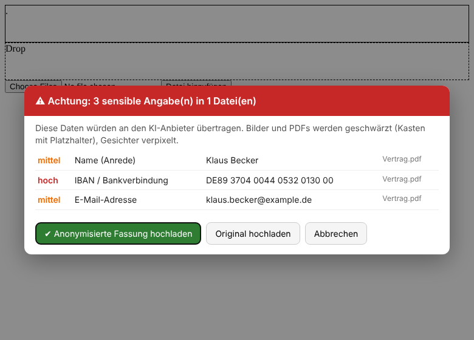</p>

## Was er kann

- **Prüft beim Hochladen, Einfügen und Kopieren.** Im Browser fängt er Drag & Drop, „Datei hinzufügen“ und Strg+V auf claude.ai, chatgpt.com, Gemini, Copilot, Mistral und Perplexity ab. Unter Windows prüft er alles, was du kopierst, auch Dateien und Screenshots.
- **Schützt auch die Desktop-Apps** von ChatGPT, Claude, Copilot und Perplexity: Ziehst du eine Datei hinein oder wählst sie über „Datei öffnen“, prüft der Datenwächter sie *vorher* – die App bekommt auf Wunsch nur die geschwärzte Fassung.
- **Erkennt sensible Daten:** IBAN, Kreditkarte und Steuer-ID (jeweils mit Prüfsumme), Sozialversicherungs-, Ausweis-, Pass-, Steuer- und Versichertennummer, Fall- und Patientennummern, API-Schlüssel, Passwörter, E-Mail, Telefon, Adressen, Geburtsdaten, Namen und Gesichter auf Fotos.
- **Du stellst ein, was geschwärzt wird.** Angaben zur Person immer. Firmen und Kundennummern, Preise und medizinische Inhalte (Diagnosen, Medikamente, Laborwerte) nach Wahl. So darf „Erkläre mir CRP 200 und 15.000 Leukos“ zur KI, ein Arztbrief mit Namen nicht.
- **Liest Bilder und Scans** mit der Windows-Texterkennung, alternativ mit Tesseract.
- **Schwärzt statt zu löschen.** PDFs und Bilder behalten ihr Layout, Funde bekommen einen Kasten mit Platzhalter wie `[IBAN_1]`, Gesichter werden verpixelt.
- **Sagt dir, *was* du hochlädst:** „Du lädst gerade Familienunterlagen hoch – willst du das?“
- **Übersetzt KI-Antworten zurück:** Aus `[PERSON_1]` wird wieder der echte Name.
- **Erkennt Namen auch ohne „Herr/Frau“** – ohne KI, mit einer Liste von rund 1.500 Vornamen und typischen Stellen wie „Liebe Mia,“, „Viele Grüße, Thomas“, „Name: …“ oder „Familie Schneider“. Ist ein Name einmal erkannt, wird er überall im Text markiert.
- **Optional mit lokalem KI-Modell:** Ein Klick in den Einstellungen lädt einmalig ein Modell (180 MB), das danach ohne Internet auf deinem PC seltene Namen („Wenzeslaus Brummer“) und Orte findet.
- **Optional mit eigenem KI-Server** (OpenAI-kompatible API mit Adresse und Token). Die KI bewertet dann Inhalte und Fotos genauer und findet auch seltene Namen.
- **KI-Aktionen** wie „Umformulieren“, „Kürzen“, „Übersetzen“ oder eigene Anweisungen. Text markieren → **✨-Knopf** neben der Markierung (in jedem Windows-Programm), Strg+Alt+Leertaste oder im Browser Rechtsklick.
- **Auch auf dem Handy:** In der Galerie, Mail- oder PDF-App auf *Teilen → Datenwächter* tippen, prüfen und schwärzen lassen, dann *Geschützt teilen → ChatGPT*. Die App läuft komplett auf dem Gerät, auch offline.

## So sieht es aus

### Im Browser

| Fund-Warnung beim Hochladen | Themen-Warnung beim Einfügen (dunkel) |
|---|---|
|  | 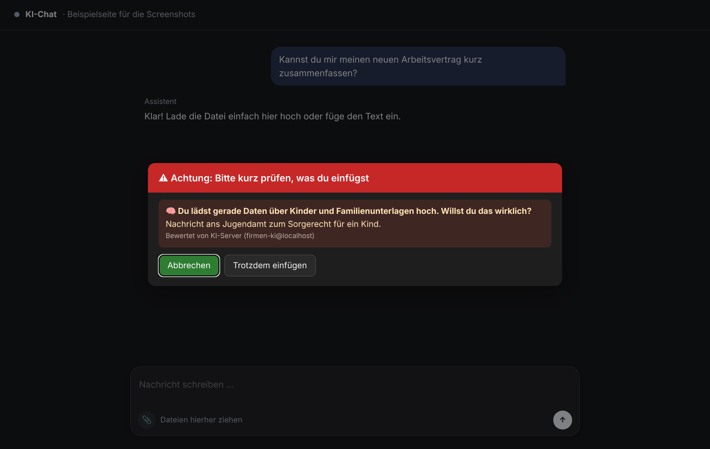 |

Klickst du in der Browserleiste auf das Datenwächter-Symbol, siehst du den Schutzstatus, kannst pausieren und siehst
die Tageszähler. Außerdem zeigt das Fenster, ob der lokale Scanner und der KI-Server verbunden sind.

<p align="center">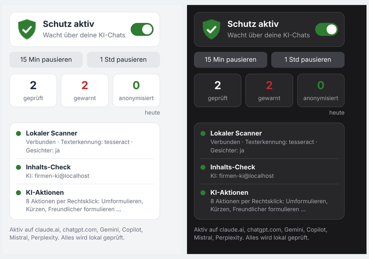</p>

### Auf dem Windows-Desktop

Ein Schild im Infobereich zeigt den Zustand: grün = aktiv, blau = prüft, rot = Warnung, orange = pausiert. Kopierst du
etwas Sensibles, erscheint unten rechts eine Benachrichtigung. Im *sicheren Modus* liegt dann schon die anonymisierte
Fassung in der Zwischenablage.

| Hell | Dunkel (folgt der Windows-Einstellung) |
|---|---|
| 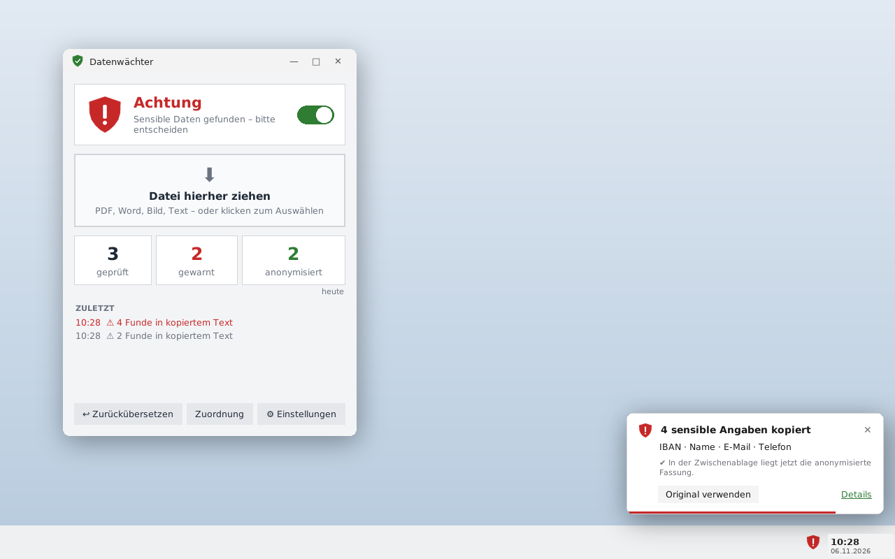 | 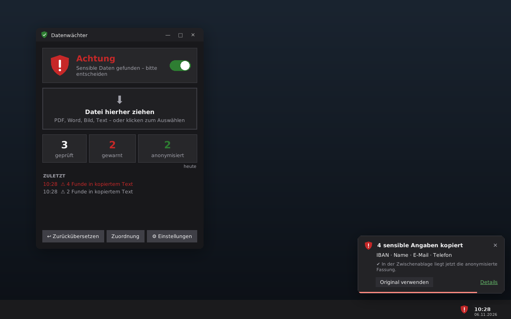 |

### Auf dem Handy

<p align="center">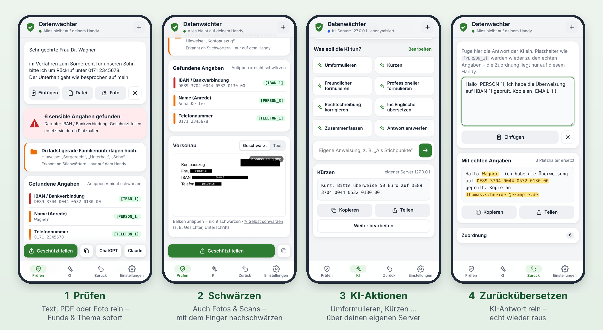</p>

```
Galerie / PDF / Mail ──Teilen──▶ Datenwächter ──Geschützt teilen──▶ ChatGPT / Claude
                                 (prüfen, schwärzen,                     │
                                  Zuordnung merken)  ◀──Teilen (Antwort)──┘  → echte Namen wieder drin
```

### Schwärzen statt hochladen

Aus einem eingescannten Brief wird ein geschwärztes PDF, aus einem Foto eines mit verpixeltem Gesicht. Hochgeladen wird
nur die rechte Fassung. Die echten Werte stehen in der Datei nicht mehr drin.

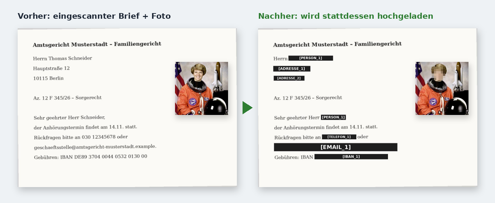

### KI-Desktop-Apps (ChatGPT, Claude, Copilot)

Ziehst du eine Datei über das Fenster der App, legt sich eine Auffangfläche darüber: Die Datei landet erst beim
Datenwächter, wird geprüft und dann – Original oder geschwärzt – an die App übergeben. Im Fenster „Datei öffnen“ der App
hält er „Öffnen“, Enter und Doppelklick kurz an, bis die Datei geprüft ist.

<p align="center">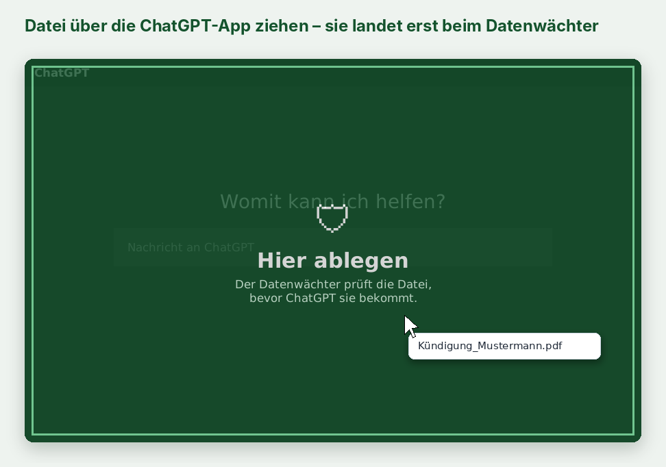</p>

### KI-Aktionen

Text markieren – in jedem Windows-Programm erscheint daneben ein kleiner **✨ KI**-Knopf. Alternativ
**Strg+Alt+Leertaste** oder im Browser Rechtsklick auf **„Mit KI bearbeiten …“**. Das Ergebnis ersetzt die Markierung, wird darunter eingefügt oder angezeigt. Tippst du etwas
ein, filtert das die Liste. Passt keine Aktion, wird das Getippte als eigene Anweisung ausgeführt.

<p align="center">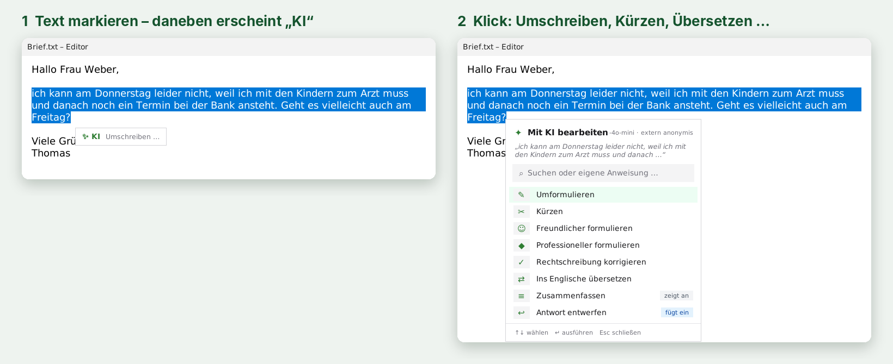</p>

| Browser | Windows (hell / dunkel) |
|---|---|
| 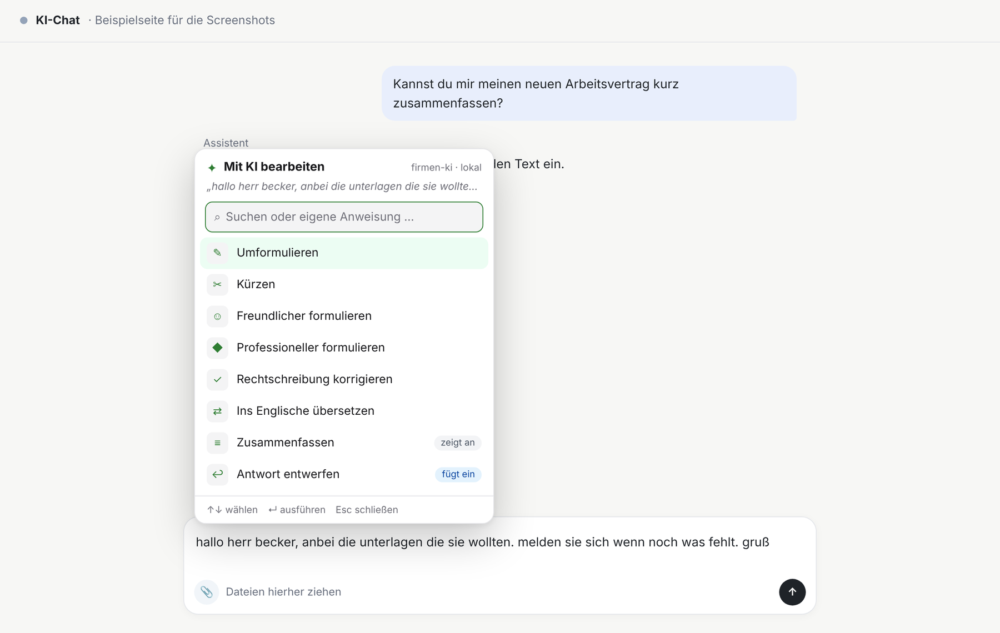 | 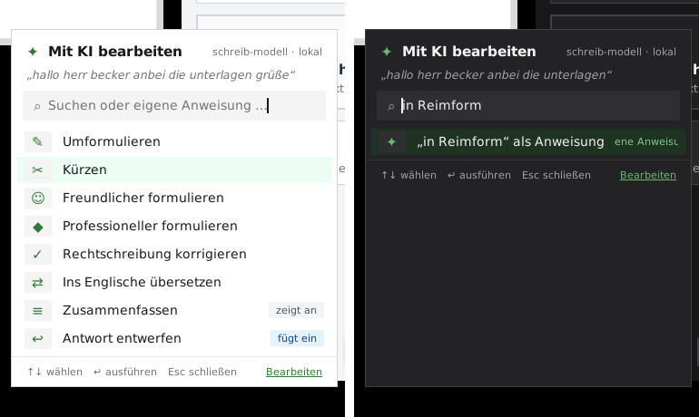 |

Eigene Aktionen legst du unter *Einstellungen → KI-Aktionen bearbeiten* an:

<p align="center">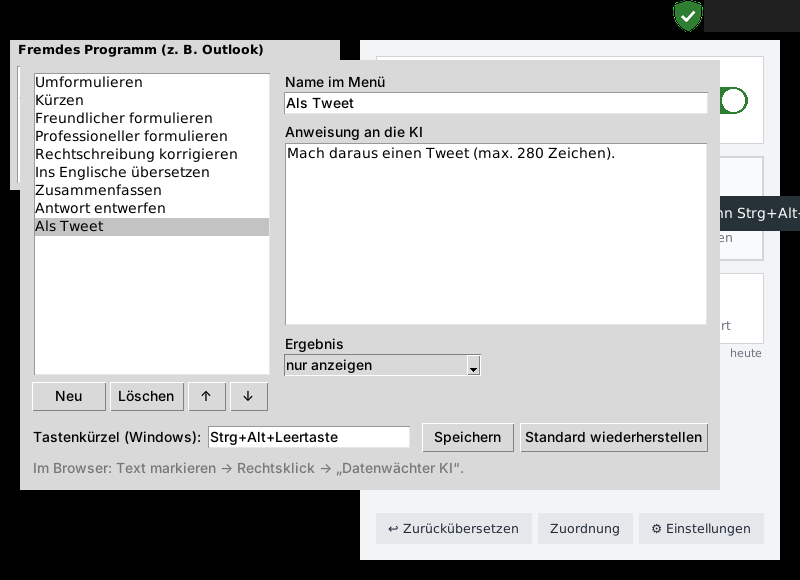</p>

## Installation

### 1. Windows-Programm

1. **`Datenwaechter-Setup-x.y.z.exe`** herunterladen. Die Datei findest du unter [Releases](../../releases) oder im letzten erfolgreichen Lauf von [*Windows-Programm*](../../actions/workflows/windows.yml) unter *Artifacts*.
2. Installieren. Du brauchst keine Admin-Rechte und kein Python. Der Installer ist nicht signiert, deshalb fragt Windows beim ersten Start nach: *Weitere Informationen → Trotzdem ausführen*.
3. Fertig: Das grüne Schild erscheint im Infobereich. Wenn du willst, startet der Datenwächter künftig automatisch mit Windows.

### 2. Browser-Erweiterung (Chrome, Edge, Brave)

1. `chrome://extensions` bzw. `edge://extensions` öffnen und den **Entwicklermodus** einschalten.
2. **Entpackte Erweiterung laden** wählen und den Ordner *Datenwächter – Browser-Erweiterung* auswählen. Eine Verknüpfung dazu legt der Installer im Startmenü an.
3. Die Verbindung zum Windows-Programm, die für PDFs, Bilder und KI-Aktionen nötig ist, richtet der Installer automatisch ein. Ohne das Programm prüft die Erweiterung nur Text.

### 3. Handy-App (Android, iPhone)

Die Handy-App ist eine installierbare Web-App. Sie braucht keinen App-Store, keine Anmeldung und keine Berechtigungen.

1. Auf dem Handy die App-Adresse öffnen. Sobald das Repo öffentlich und GitHub Pages aktiv ist, lautet sie `https://<github-name>.github.io/<repo>/`.
2. **Android (Chrome):** *Einstellungen → App installieren* oder Menü ⋮ → *Zum Startbildschirm hinzufügen*. Danach steht der Datenwächter im **Teilen-Menü** aller Apps.
   **iPhone (Safari):** *Teilen → Zum Home-Bildschirm*. Apple lässt Web-Apps nicht ins Teilen-Menü. Dateien kommen deshalb über *Datei*, *Foto* oder *Einfügen* in die App, das Weiterteilen an ChatGPT klappt aber auch dort.
3. Optional unter *Einstellungen → Texterkennung* die Erkennungsdaten (ca. 5 MB) für den Offline-Betrieb laden.

Auf eigenem Server: `cd mobile && npm ci && npm run build` und den Ordner `mobile/dist/` per **https** ausliefern (z. B. nginx, Caddy, Netlify).

### Mit Python (für Entwickler und andere Systeme)

```bash
pip install ".[windows,gesichter]"     # unter Windows: Tray, Windows-Texterkennung, Gesichter
datenwaechter-gui                      # Fenster + Tray-Symbol
datenwaechter browser-bruecke          # Browser-Erweiterung mit dem Scanner verbinden
```

Unter Linux/macOS: `pip install ".[tesseract,gesichter]"` und Tesseract mit Sprachpaket Deutsch installieren.

## Lokales KI-Modell (optional)

Unter *Einstellungen → Lokales KI-Modell → Laden* holt der Datenwächter einmalig ein kleines Sprachmodell (180 MB) von
Hugging Face. Danach läuft es **ohne Internet und ohne Server** auf dem Prozessor: etwa eine Sekunde zum Starten, dann
wenige Millisekunden pro Text, rund 300 MB Arbeitsspeicher. Es findet Namen und Orte, die keine Regel und keine
Vornamenliste kennt.

- Modell: [bert-base-multilingual-cased-ner-hrl](https://huggingface.co/Davlan/bert-base-multilingual-cased-ner-hrl)
  von David Adelani (Lizenz AFL-3.0), als [ONNX-Fassung](https://huggingface.co/Xenova/bert-base-multilingual-cased-ner-hrl) mit 8-Bit-Gewichten.
- Ausgeführt mit onnxruntime, ohne PyTorch und ohne Python-Pickles. Die Dateien enthalten nur Daten, haben einen festen
  Stand und werden per SHA-256 geprüft. Ein abgebrochener Download wird beim nächsten Mal fortgesetzt.
- Gemessen an GraSCCo (siehe unten): Orte 59 % → 81 %, Adressen 93 % → 96 %, Namen 97,5 % → 97,8 %. Dazu kommt
  ein zusätzlicher Fehlalarm.
- Kommandozeile: `datenwaechter modell laden`, `datenwaechter modell` (Status), `datenwaechter modell entfernen`.
  Für eigene Spiegel im Firmennetz: `DATENWAECHTER_MODELL_QUELLE`.

## Eigener KI-Server (optional)

Ohne KI arbeitet der Datenwächter mit Regeln und Stichwörtern. Mit einer KI wird er genauer. Unter *Einstellungen →
KI-Server einrichten* trägst du die **API-Adresse** und dein **Token** ein. Das funktioniert mit jedem Dienst, der die
OpenAI-Schnittstelle (`/v1/chat/completions`) spricht, z. B. OpenAI, Azure OpenAI, Mistral, OpenRouter, ein
Firmen-Gateway, LM Studio oder vLLM.

<p align="center">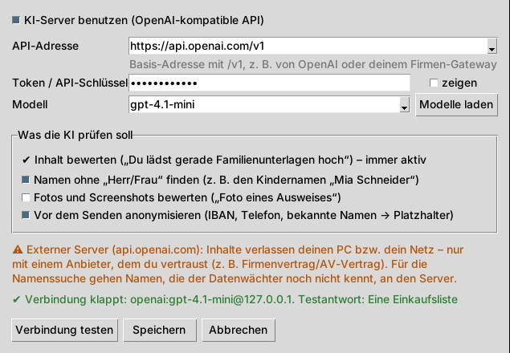</p>

Du legst fest, was die KI prüfen soll:

- **Inhalt bewerten:** z. B. „Du lädst gerade Personal- und Arbeitsunterlagen hoch“.
- **Namen ohne „Herr/Frau“ finden**, z. B. den Kindernamen „Mia Schneider“ in einem Gerichtsbrief.
- **Fotos und Screenshots bewerten**, z. B. „Foto eines Ausweises“.
- **Vor dem Senden anonymisieren:** IBAN, Telefon und bekannte Namen gehen nur als Platzhalter raus.

Ein- und ausschalten geht jederzeit im Tray-Menü mit **„KI-Server benutzen“**: Ausgeschaltet geht nichts mehr an den
Server, Adresse und Token bleiben gespeichert.

Bei einem **externen Server** sagt der Dialog genau, was deinen Rechner verlässt. Standardmäßig wird vorher
anonymisiert, und Fotos werden nicht gesendet. Das Token liegt in der Windows-Anmeldeinformationsverwaltung. Für
Firmen-Rollouts gibt es zusätzlich die Umgebungsvariablen `DATENWAECHTER_LLM_URL`, `DATENWAECHTER_LLM_TOKEN` und
`DATENWAECHTER_LLM_MODELL`.

```bash
datenwaechter ki-server --url https://gateway.firma.de/v1 --token - --modell gpt-4.1-mini --testen
```

## Datenschutz: Was passiert mit meinen Daten?

| | Ohne KI-Server | Mit eigenem KI-Server |
|---|---|---|
| Erkennung von IBAN, Namen, Adressen … (auch mit lokalem KI-Modell) | lokal | lokal |
| Texterkennung, Gesichter, Schwärzen | lokal | lokal |
| Inhalts-Check | lokal (Stichwörter) | Text an deinen Server, standardmäßig anonymisiert |
| Fotos bewerten | – | nur wenn eingeschaltet |
| Namen ohne Anrede finden | – | nur wenn eingeschaltet; bekannte Angaben vorher als Platzhalter |
| Statistik, Telemetrie | nur Tageszähler (Zahlen) auf deinem PC | dito |

Die Zuordnung der Platzhalter (`[PERSON_1]` = …) bleibt auf deinem Rechner, damit du KI-Antworten zurückübersetzen kannst.
Die Handy-App arbeitet genauso: Erkennung, Texterkennung und Schwärzen laufen im Browser auf dem Gerät. Einstellungen,
eigene Aktionen und die Zuordnung liegen nur im Speicher des Handys. Die App lädt nichts von fremden Servern (keine CDNs, kein Tracking).

## Was erkannt wird

| Stufe | Daten |
|---|---|
| **hoch** | IBAN (auch mit OCR-Lesefehlern wie „O“ statt „0“), Kreditkarte, Steuer-ID, Sozialversicherungsnummer, Ausweis-/Passnummer, API-Schlüssel (Anthropic, OpenAI, AWS, GitHub, Google, Slack, Stripe), private Schlüssel, Tokens, Passwörter, Datenbank-Zugänge |
| **mittel** | Namen (Vornamenliste, Anrede, Gruß, Formularfelder, Familie; mit lokalem Modell oder KI-Server auch seltene), E-Mail, Telefon, Straße + Hausnummer, PLZ + Ort, Geburtsdatum und -jahr (viele Schreibweisen), Gesichter |
| **niedrig** | IP-Adressen |
| **Themen** | Familie, Gesundheit, Finanzen, Recht, Personal/Arbeit, Ausweise, Firmeninterna, besonders geschützte Daten nach Art. 9 DSGVO ([Stichwörter](datenwaechter/kategorien.json)) |

### Was soll geschwärzt werden?

Einstellbar im Windows-Programm (*Einstellungen*) und in der Handy-App. Die Browser-Erweiterung übernimmt die Einstellung
des Windows-Programms.

| Gruppe | Standard | Was |
|---|---|---|
| Angaben zur Person | immer | Name, Adresse, Geburtsdatum, Telefon, E-Mail, IBAN, Ausweis-, Steuer- und Versichertennummer, Fall-/Patientennummer, Kfz-Kennzeichen, IMEI, GPS |
| Firmen & Kunden | an | Firmen („Müller Bau GmbH“), Kliniken und Praxen, Kunden-, Vertrags-, Angebots- und Rechnungsnummern, USt-IdNr., Aktenzeichen |
| Preise & Beträge | aus | „1.250,00 €“ |
| Medizinische Inhalte | aus | Diagnosen, ICD-Codes, Medikamente, Laborwerte |
| Themen-Warnung nur mit Person | an | „Du lädst Gesundheitsdaten hoch“ nur, wenn auch jemand erkennbar ist |

### Wie gut erkennt er?

Gemessen an [GraSCCo](https://zenodo.org/records/15747389): 63 deutsche Arztbriefe mit erfundenen Personen, in denen
Fachleute jede personenbezogene Stelle markiert haben. Ein Treffer zählt, wenn der Datenwächter mindestens 80 % der Stelle schwärzt.

| Angabe | erkannt |
|---|---|
| Namen (Patienten, Ärzte, Angehörige) | 314 von 322 (97 %) |
| Geburtsdaten | 59 von 61 (97 %) |
| Straße, PLZ | 69 von 74 (93 %) |
| Telefon, Fax, E-Mail | 24 von 28 (86 %) |
| Fall-, Patienten-, Befundnummern | 29 von 35 (83 %) |
| **zusammen** | **495 von 520 (95 %)** |

Schwächer sind Orte ohne Straße („in Graz“, 59 %, mit lokalem KI-Modell 81 %) und Klinik-Namen (70 %). Fehlalarme: 6, alles Abteilungsnamen wie
„Universitätsklinik für Dermatologie“. Nachmessen: `python tests/benchmark_grascco.py` (lädt die Daten einmal herunter, sie
landen nicht im Repository).

## Grenzen und häufige Fragen

- **Kann die Handy-App Uploads in der ChatGPT-App abfangen?** Nein. iOS und Android lassen keine App die Zwischenablage im Hintergrund lesen oder in fremde Apps eingreifen. Deshalb gilt auf dem Handy: erst *Teilen → Datenwächter*, dann *Geschützt teilen → ChatGPT*.
- **Handy-App mit eigenem KI-Server?** Klappt, wenn der Server per **https** erreichbar ist und Zugriffe aus dem Browser erlaubt (CORS). Bei OpenAI, OpenRouter und Mistral ist das so. Für LM Studio, Ollama & Co. im Heimnetz brauchst du einen Reverse-Proxy mit https.
- **Warum gibt es keinen Eintrag im Windows-Rechtsklick-Menü?** Fremde Programme lassen sich dort nicht erweitern. Deshalb erscheint beim Markieren der ✨-Knopf (abschaltbar unter *KI-Aktionen bearbeiten*), zusätzlich gibt es Strg+Alt+Leertaste.
- **Wie zuverlässig ist die Namenserkennung?** Häufige Vornamen (deutsch und international) und Namen an typischen Stellen findet sie zuverlässig. Seltene Namen ohne Zusammenhang („Wenzeslaus“) erkennen das lokale KI-Modell oder der eigene KI-Server. Wörter, die auch Namen sein können („Ernst“, „Rose“, „August“, „Claude“), zählen nur mit Nachnamen oder in eindeutigem Zusammenhang. Die Liste steht in [`datenwaechter/vornamen.txt`](datenwaechter/vornamen.txt) und lässt sich erweitern.
- **Desktop-Apps wie die ChatGPT- oder Claude-App?** Geschützt (Windows): Ziehst du eine Datei über das App-Fenster, legt sich eine Auffangfläche darüber – die Datei landet erst beim Datenwächter. Im Fenster „Datei öffnen“ der App hält er „Öffnen“, Enter und Doppelklick kurz an und prüft. Die App bekommt auf Wunsch nur die geschwärzte Fassung. Grenzen: Apps mit eigenem (nicht Windows-)Auswahlfenster; die App muss Einfügen von Dateien (Strg+V) können. Abschaltbar in den Einstellungen.
- **Warum Entwicklermodus?** Die Erweiterung ist (noch) nicht im Chrome Web Store.
- **Was wird nicht geschwärzt?** Gesundheitsangaben im Fließtext (außer Diagnosen, ICD-Codes, Medikamenten und Laborwerten, wenn *Medizinische Inhalte* an ist) lösen nur eine Warnung aus. Handschrift erkennt die Texterkennung kaum. Bilder *in* Word-Dateien werden nicht geprüft.
- **Ist das eine Garantie?** Nein. Der Datenwächter ist eine Schutzschicht gegen Versehen. Regeln und KI haben Lücken.

## Kommandozeile

```bash
datenwaechter scan Vertrag.pdf Foto.jpg kunden.csv     # Exit-Code 2 = kritische Funde, 1 = mittlere
datenwaechter anonymisieren Scan.pdf --zuordnung       # schreibt Scan_anonymisiert.pdf
datenwaechter aktion Umformulieren --text "…"          # KI-Aktion auf Text anwenden
datenwaechter aktionen --neu "Als Tweet" --anweisung "Mach daraus einen Tweet" --modus anzeigen
```

## Entwicklung

```bash
pip install -e ".[dev]"
pytest                                   # Regeln, Schwärzen, OCR, Gesichter, KI-Anbindung (simulierte Server), Oberfläche
node --test tests/detectors.test.js      # Browser-Regeln = Python-Regeln
python tests/korpus_bericht.py           # eigene Testdokumente: was gefunden, was verpasst wird
python tests/benchmark_grascco.py        # Messung an 63 Arztbriefen (GraSCCo, wird heruntergeladen); --modell mit KI-Modell
node tests/e2e_extension.js              # Erweiterung in echtem Chromium (SITE=chatgpt.com für ChatGPT)
node tests/e2e_ki_aktionen.js            # KI-Aktionen im Browser
python tests/windows_smoke.py            # nur Windows: Zwischenablage, OCR, Tastenkürzel, Benachrichtigung, Notepad
cd mobile && npm ci && npm run build && npm test   # Handy-App in Chromium mit Pixel-7-Emulation
```

Bei jedem Push baut [GitHub Actions](.github/workflows/windows.yml) auf echtem Windows. Der Lauf führt die Tests und
den Windows-Praxistest aus, baut das Programm (PyInstaller) und den Installer (Inno Setup) und installiert ihn testweise
still und wieder ab. Bei einem Tag `v*` entsteht ein Release. Selbst bauen kannst du mit `packaging\build_windows.ps1`.
Die Handy-App testet [ein eigener Workflow](.github/workflows/handy-app.yml) bei jedem Push. Auf `main` veröffentlicht er
sie zusätzlich auf GitHub Pages.

```
datenwaechter/      Python-Paket: Regeln, OCR, Schwärzen, KI-Anbindung, Fenster, Tray, Browser-Brücke
extension/          Browser-Erweiterung (Manifest V3)
mobile/             Handy-App (installierbare Web-App): pdf.js, tesseract.js, jsPDF – alles mitgeliefert
packaging/          PyInstaller-Rezept, Installer, Programm-Symbol
tests/              pytest, Browser- und Windows-Tests
```

Die Erkennungsregeln gibt es zweimal, in `datenwaechter/detectors.py` (mit `namen.py`, `inhalte.py`) und
`extension/detectors.js`. Die Tests prüfen beide mit denselben Beispielen; `tests/test_gleichstand.py` vergleicht die Funde
beider Fassungen Stelle für Stelle. Die Handy-App nutzt dieselbe `extension/detectors.js`. Ändern sich die Stichwörter, erzeugst du die Browser-Fassung so neu:
`python -c "import datenwaechter.content_check as c; c.write_extension_categories()"`.

## Mitmachen

Fehler und Ideen bitte als Issue melden. Sicherheitslücken bitte nicht öffentlich, siehe [SECURITY.md](SECURITY.md).
Wie du beiträgst, steht in [CONTRIBUTING.md](CONTRIBUTING.md), Änderungen im [CHANGELOG](CHANGELOG.md).

## Danksagung

[pypdfium2](https://github.com/pypdfium2-team/pypdfium2), [pypdf](https://github.com/py-pdf/pypdf),
[OpenCV](https://opencv.org), [Tesseract](https://github.com/tesseract-ocr/tesseract), [pystray](https://github.com/moses-palmer/pystray),
[PyInstaller](https://pyinstaller.org), [Inno Setup](https://jrsoftware.org/isinfo.php), [pdf.js](https://mozilla.github.io/pdf.js/),
[tesseract.js](https://tesseract.projectnaptha.com), [jsPDF](https://github.com/parallax/jsPDF), [JSZip](https://stuk.github.io/jszip/).
Das lokale KI-Modell stammt von David Adelani (AFL-3.0), die ONNX-Fassung von Xenova.
Gemessen wird mit GraSCCo_PII (Lohr et al., [Zenodo](https://zenodo.org/records/15747389), CC BY 4.0).
Das Testfoto stammt aus einem gemeinfreien NASA-Foto (über [scikit-image](https://scikit-image.org)). Alle Personen,
Adressen, Kontonummern und Firmen in Beispielen und Screenshots sind erfunden.
